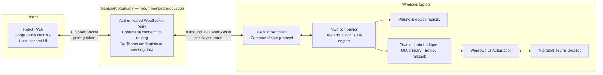

# Teams Mobile Remote — Architecture Plan

> **Status:** planning only · **Target:** Windows laptop + mobile browser/PWA · **Initial controls:** microphone, camera, raise/lower hand

## 1. Product decision and boundaries

Build a **mobile-first remote control** for the Teams meeting running on one Windows laptop. The user opens an installable React PWA on a phone, pairs it with the companion running on the laptop, and presses three large controls:

- mute / unmute microphone;
- turn camera on / off;
- raise / lower hand.

The Windows companion is the only component that touches Teams. It observes and invokes Teams' accessible controls with Windows UI Automation (UIA), with keyboard shortcuts available only as a carefully gated fallback. UIA is an accessibility framework intended for programmatic interaction with desktop UI; its properties, control patterns, and events are a reasonable integration surface, but Teams does not promise a stable automation contract for this product. [Microsoft UI Automation overview](https://learn.microsoft.com/en-us/windows/win32/winauto/uiauto-uiautomationoverview)

### Goals

1. Give one paired phone responsive, obvious controls for the user's current Teams meeting.
2. Keep Teams credentials, meeting content, and control execution on the laptop.
3. Make every outcome visible: confirmed state, pending request, unsupported, or uncertain.
4. Survive temporary Wi-Fi loss, Teams UI changes, and companion restarts without silently applying the wrong toggle.
5. Make control adapters replaceable so a future official integration can supersede UIA.

### Non-goals for v1

- Joining, leaving, scheduling, recording, chat, participant management, or reading meeting content.
- Controlling multiple laptops or multiple concurrent meetings.
- Circumventing Teams policies, admin controls, meeting role restrictions, or device permission prompts.
- Treating a successful key press as proof that Teams changed state.
- A cloud service that stores Teams tokens, audio/video, meeting text, or long-term activity history.
- macOS, Android native, iOS native, and Teams web support (design only allows later adapters).

### Key feasibility constraint

Teams documents keyboard shortcuts for desktop meetings, including `Ctrl+Shift+M` (mute), `Ctrl+Shift+O` (camera), and `Ctrl+Shift+K` (raise/lower hand). Shortcuts may be unavailable in some focused/sharing contexts, and they are toggle operations, not a reliable state API. [Teams shortcuts](https://support.microsoft.com/en-us/accessibility/teams/keyboard-shortcuts-for-microsoft-teams) Therefore, **UIA observation + explicit UIA invocation is the primary path**. Keyboard injection is a fallback only when the companion can first determine the current state and safely foreground Teams.

## 2. Recommended deployment shape

There are two product components, plus a very small transport service in the production option.



### Why a relay is the recommended PWA transport

The companion and PWA are the two applications. A relay is infrastructure, not a third client app. It avoids the fragile production pattern of a public HTTPS PWA calling `http://laptop-ip` or `ws://laptop-ip`: browsers enforce secure-context/mixed-content rules, private-network access policies vary, mobile networks isolate devices, and a laptop-local TLS certificate is difficult for a phone to trust. The companion makes an **outbound** TLS WebSocket, so the phone never discovers or connects to the laptop directly.

**Development-only LAN mode** may expose a locally hosted page/socket on the same Wi-Fi for rapid prototyping. It must be clearly marked unsupported for production and must not be the security design. Do not build a production plan around self-signed certificates, port forwarding, or exposing a Windows listener to the Internet.

### Trust and data flow

```mermaid
sequenceDiagram
  participant U as User
  participant P as Phone PWA
  participant R as Relay
  participant C as Windows Companion
  participant T as Teams desktop

  U->>C: Start companion; scan one-time QR in PWA
  C->>R: Register outgoing device session (TLS)
  P->>R: Redeem single-use pairing code (TLS)
  R-->>P: Device-scoped session token
  P->>R: Command with idempotency key
  R->>C: Route command only to paired companion
  C->>T: Inspect state / invoke accessible control
  T-->>C: UIA property/event or verification result
  C->>R: Command result + authoritative state revision
  R-->>P: Result and state update
```

## 3. Component responsibilities

| Component | Responsibilities | Must not do |
|---|---|---|
| React PWA | Pair, reconnect, show three controls and connection/state quality, send intent-bearing commands, cache only non-sensitive UI preferences | Access Teams, infer success locally, retain pairing secrets beyond their intended lifetime |
| Relay | Authenticate sessions, enforce one device route and rate limits, forward encrypted TLS messages, expire connections | Inspect Teams, retain meeting data, make control decisions, accept anonymous commands |
| .NET companion | Tray UX, pairing QR, transport client, command dedupe, state model, audit-in-memory, UIA/hotkey control adapter, diagnostics | Upload Teams credentials/content; execute a command when lock screen, policy, or adapter safety rules prohibit it |
| Teams adapter | Detect eligible Teams meeting window, read UIA properties/patterns/events, invoke a control, verify result | Use screen coordinates, hard-code a single button label, claim a state it cannot confirm |

### Windows companion structure

```text
TeamsRemote.Companion
├── AppShell                 tray, onboarding, diagnostics, settings
├── PairingService           QR generation, single-use redemption, device revocation
├── ConnectionClient         relay session, heartbeats, backoff
├── CommandProcessor         schema validation, authorization, dedupe, acknowledgements
├── MeetingStateStore        versioned in-memory snapshot and confidence rules
├── TeamsAdapter
│   ├── ITeamsController     observe(), execute(), health()
│   ├── UiaTeamsController   primary implementation
│   └── HotkeyFallback       opt-in, focus-gated fallback
├── SafetyPolicy             lock-screen, foreground, rate, consent, uncertain-state gates
└── Diagnostics              redacted logs and UIA capability report
```

Use a separate `ITeamsController` abstraction from day one. The app shell and protocol must never know button names, automation IDs, or hotkeys.

## 4. Teams control strategy

### Primary: UI Automation adapter

1. Locate a candidate Teams desktop process/window and identify an active meeting control surface.
2. Query the relevant UIA subtree with narrow conditions (window/process + control type). Avoid walking the desktop tree frequently.
3. Classify each control from a versioned capability map: UIA control type, normalized accessible name/localized aliases, supported pattern (`Toggle`, `Invoke`, or `SelectionItem`), and expected state property.
4. Subscribe to relevant UIA property/structure events while a meeting is active; re-query after a short debounce.
5. For a desired-state command, read state immediately before action, invoke only if required, then wait for an event or bounded re-query to verify it.

UIA exposes desktop elements as an automation tree and supports properties, control patterns, and specific event subscriptions. The companion should use events to reduce polling, but treat re-query as necessary verification because an event does not necessarily mean a visible state changed. [UIA tree](https://learn.microsoft.com/en-us/windows/win32/winauto/uiauto-treeoverview) · [UIA events](https://learn.microsoft.com/en-us/windows/win32/winauto/uiauto-uiautomationoverview)

### Secondary: keyboard shortcut adapter (opt-in)

Use only if all conditions hold: the user enables it in settings, a supported meeting is detected, the corresponding state is fresh and known, Teams can be safely made foreground, and the action is not rate-limited. Restore the prior foreground window if possible. Tell the user this can interrupt typing or fail when Teams is not accepting shortcuts. Never inject a toggle shortcut when the current state is unknown.

### Capability tiers

| Tier | Meaning | PWA behavior |
|---|---|---|
| `verified` | UIA can read and invoke/verify the control | Enable desired-state action |
| `fallback` | Known state and opt-in shortcut path available | Enable with “shortcut fallback” indicator |
| `observe-only` | State is readable but safe execution unavailable | Show state; disable action |
| `unavailable` | No meeting/control or state unknown | Disable action and explain why |

## 5. Command and state protocol

Use JSON messages over a versioned, authenticated WebSocket. Relay messages are opaque to product logic. All timestamps use UTC ISO-8601; all IDs are UUIDs. Enforce maximum message size (for example 16 KB) and reject unknown protocol versions.

### Envelope

```json
{
  "version": 1,
  "type": "command",
  "messageId": "uuid",
  "correlationId": "uuid",
  "deviceId": "uuid",
  "sentAt": "2026-10-24T09:00:00Z",
  "payload": {}
}
```

### Commands: intent, not blind toggles

```json
{
  "type": "command",
  "messageId": "d40b...",
  "correlationId": "d40b...",
  "payload": {
    "command": "set_microphone",
    "desired": "muted",
    "expectedStateRevision": 42
  }
}
```

Supported v1 commands are `set_microphone` (`muted` | `unmuted`), `set_camera` (`on` | `off`), and `set_hand` (`raised` | `lowered`). The PWA may render a toggle-like control, but it sends an explicit desired value based on its last confirmed snapshot. If the supplied revision is stale, the companion refreshes before action; it never blindly retries an old toggle.

### Results and errors

```json
{
  "type": "command_result",
  "correlationId": "d40b...",
  "payload": {
    "status": "confirmed",
    "stateRevision": 43,
    "state": { "microphone": "muted" },
    "observedAt": "2026-10-24T09:00:01Z"
  }
}
```

Allowed `status`: `accepted`, `confirmed`, `rejected`, `failed`, `timed_out`, `unsupported`, `state_uncertain`. `accepted` means the companion received the request—not that Teams changed. Errors use stable machine codes such as `NO_ACTIVE_MEETING`, `CONTROL_NOT_FOUND`, `PAIRING_REQUIRED`, `STALE_COMMAND`, `LOCKED_SESSION`, `RATE_LIMITED`, `FOREGROUND_REQUIRED`, and `VERIFICATION_FAILED`.

### Deduplication and ordering

- The phone reuses the same `messageId` while retrying; companion stores recent IDs/results for at least 10 minutes.
- The companion serializes actions per control and publishes a monotonically increasing `stateRevision` only after its state reducer changes.
- Commands are not assumed ordered across reconnects. `expectedStateRevision` protects against an old UI request.
- One command must complete or time out before the same control accepts another request. A 300–500 ms debounce in the PWA prevents double taps; the companion remains the authority.

## 6. State synchronization and UI model

The companion owns the canonical snapshot for the paired session. The PWA is a cache and always reconciles from a `state_snapshot` after connect/reconnect.

```json
{
  "type": "state_snapshot",
  "payload": {
    "stateRevision": 43,
    "meeting": "active",
    "controls": {
      "microphone": { "value": "muted", "capability": "verified", "confidence": "confirmed" },
      "camera": { "value": "unknown", "capability": "observe-only", "confidence": "stale" },
      "hand": { "value": "lowered", "capability": "verified", "confidence": "confirmed" }
    },
    "connection": "connected",
    "observedAt": "2026-10-24T09:00:01Z"
  }
}
```

State values are `on`, `off`, `muted`, `unmuted`, `raised`, `lowered`, or `unknown`. Confidence is `confirmed`, `pending`, `stale`, or `unknown`. On the phone:

- confirmed state is colored and actionable;
- pending is visually busy and blocks repeat action for that control;
- unknown/stale is never shown as an affirmative state;
- disconnected keeps the last snapshot dimmed with no active command buttons;
- capability/failure explanations are available in a compact status drawer, not buried in logs.

Do not persist current microphone/camera/hand state as if it survives a new meeting. A new meeting, Teams restart, UIA root change, laptop unlock, or adapter error resets relevant state to `unknown` until observed again.

## 7. Security and privacy

### Pairing

1. Companion shows a QR code containing a short-lived, single-use pairing challenge—not a reusable device secret.
2. PWA scans it and authenticates to the relay over TLS.
3. The relay asks the companion to approve the challenge; companion shows a local confirmation with a matching short code/device label.
4. On approval, relay issues an opaque, device-scoped, revocable session credential with expiry/rotation.
5. Companion lists paired devices and supports one-tap revoke; lost phone = revoke from tray UI.

For v1, permit one active paired phone per companion. This minimizes conflict handling and makes the user's control surface clear.

### Required controls

- TLS 1.2+ for PWA↔relay and companion↔relay; do not expose a public laptop listener.
- Authenticate both endpoints; authorize every command by `deviceId` + active pairing.
- Rate limit commands (for example, 5 per control per 10 seconds) and cap all payload sizes.
- Store companion credentials using Windows DPAPI/Credential Manager; store PWA tokens in the least persistent browser storage practical, rotate them, and require re-pair after explicit sign-out/revocation.
- Log only event IDs, outcome codes, and timing. Never log QR secrets, bearer tokens, UIA full text trees, meeting titles, participant names, or Teams content.
- Require the interactive Windows user session; disable control when the workstation is locked or the companion detects a different desktop/user session. UIA is not designed for cross-user “Run as” interaction. [UIA overview](https://learn.microsoft.com/en-us/windows/win32/winauto/uiauto-uiautomationoverview)
- Obtain user consent before enabling keyboard fallback; no silent focus stealing.

## 8. Failure modes and safe behavior

| Situation | Detection | Required behavior |
|---|---|---|
| Phone/relay disconnects | heartbeat timeout | Disable PWA controls; reconnect with exponential backoff; sync snapshot before re-enable |
| Companion restarts | new session ID | PWA reauthenticates/reconnects; all control states become unknown until scanned |
| Teams not running/no meeting | process/window/capability scan | Publish `NO_ACTIVE_MEETING`; no synthetic input |
| Teams changes UI/localization | adapter cannot resolve control or verify | Mark that control unavailable, collect redacted capability diagnostics, do not coordinate-click |
| State cannot be read | stale observation/toggle pattern absent | Disable intent command; never send blind hotkey toggle |
| UIA action succeeds but state is not verified | timer expires | Return `state_uncertain`; re-scan, do not retry automatically |
| Another device/user changes Teams | UIA event/re-query | Increment revision and push snapshot to PWA |
| Teams has focus-sensitive shortcut limitation | foreground/focus guard | Do not invoke fallback; explain `FOREGROUND_REQUIRED` |
| Laptop locked/sleeping | Windows session/power event | Stop actions and mark unavailable; restore only after fresh observation |
| Duplicate or delayed message | dedupe / stale revision | Return prior result or `STALE_COMMAND`; do not reapply |

## 9. Implementation phases and acceptance gates

### Phase 0 — feasibility spike (mandatory)

Build no remote UI yet. On representative Teams desktop versions and accounts, use inspectable diagnostics to verify whether microphone, camera, and hand controls expose usable names/patterns/state events in an active meeting. Record only redacted selector facts. Decide each control's capability tier. **Gate:** do not proceed with a control that cannot be read and verified reliably.

### Phase 1 — companion proof of control

Create the `.NET` tray companion and `ITeamsController`, in-memory state machine, diagnostics screen, and UIA adapter for one control (microphone). Add user-confirmed local test action. **Gate:** 50 repeated state transitions in a test meeting with no unverified false “success.”

### Phase 2 — secure pairing and transport

Implement relay contract, outbound WebSocket client, QR pairing approval, device revoke, heartbeats, command dedupe, and schema/authorization tests. **Gate:** unpaired/expired/revoked devices cannot command; reconnect never replays an old action.

### Phase 3 — React PWA

Implement the three-button mobile interface, QR flow, pending/confirmed/unknown rendering, reconnect sync, and accessible touch targets. Start with microphone only. **Gate:** a phone request is visibly pending then confirmed/failed; it never displays a made-up state.

### Phase 4 — complete controls and fallback

Add camera and hand behind their individual capability flags. Add opt-in hotkey fallback only after UIA paths are characterized. **Gate:** each control independently passes the test matrix; unsupported controls remain disabled.

### Phase 5 — hardening and pilot

Add crash recovery, redacted support bundle, accessibility pass, abuse/rate tests, telemetry consent, installer/update plan, and a small real-user pilot across Teams updates. **Gate:** documented operational limits and a one-click disable/revoke path.

## 10. Testing strategy

| Layer | What to test |
|---|---|
| Protocol | JSON schema/version rejection, authorization, expiry, dedupe, retries, stale revisions, size/rate limits |
| State engine | reducers, confidence transitions, ordering, timeout behavior, new-meeting/restart resets |
| Adapter unit tests | selector normalization, capability classification, desired-state decision, no-action-when-unknown |
| Adapter integration | Teams desktop build/account matrix; active/idle meeting; mic/camera permissions; window minimized; focus in chat; shared content; different UI language |
| PWA | touch/keyboard accessibility, QR pairing, offline/reconnect, pending visual, stale state, no double submit |
| End-to-end | QR to command to UIA verification to PWA snapshot; relay loss; laptop sleep/lock; Teams restart; device revocation |
| Security | token theft simulation, replay, cross-device routing attempt, payload fuzzing, logs/support-bundle redaction |

Maintain a **compatibility matrix**: Windows version, Teams client channel/version, account type, UI language, and each control's `verified/fallback/observe-only/unavailable` result. Teams is updated independently, so this matrix is a release requirement, not a one-time test.

## 11. Open questions to resolve before committing

1. Which Teams desktop client channels and account types must be supported (work/school, personal, classic/new client)?
2. Is a small managed relay acceptable, and where may it be hosted? If not, a PWA production transport needs a separately approved secure-network design.
3. Is the first release allowed to support only English UI while localization selectors mature?
4. Must the app work when Teams is minimized, on a different virtual desktop, while PowerPoint/Whiteboard is shared, or when the laptop is locked? (Recommended answer: no for v1 unless verified.)
5. Is keyboard fallback acceptable given focus disruption, or should unsupported UIA controls simply be disabled?
6. What telemetry/privacy policy and code-signing/update channel are required for the Windows companion?
7. Is one phone per laptop sufficient for v1? (Recommended: yes.)

## 12. Guidance for future AI coding agents

### Non-negotiable implementation rules

- This is an assistive remote, not an unofficial Teams API. Keep UIA-specific logic isolated behind `ITeamsController`.
- Do not use pixel/image matching, screen coordinates, arbitrary mouse clicks, browser DevTools, Teams internals, reverse-engineered APIs, or stored Teams credentials.
- Do not implement `toggle_*` as the wire protocol. Use desired-state commands and reject action when state cannot be trusted.
- A successful `Invoke()` or key injection is not confirmation. Verification must update state before `confirmed` is emitted.
- Keep the relay stateless regarding Teams and meeting data; it routes only device-scoped messages.
- Favor an unavailable control over an unsafe action. Feature-flag each control independently.
- Produce tests and redacted diagnostics alongside each adapter behavior. Never paste live UIA trees containing meeting data into logs/issues.

### Starter prompt: companion agent

```text
You are implementing Phase <N> of the Teams Mobile Remote architecture. Read architecture.md first and treat it as authoritative. Work only in the Windows companion boundary described there. Keep all Teams interaction behind ITeamsController. Start with a capability-reporting UIA spike; do not automate clicks by coordinates or send hotkeys. For every action, require fresh observed state, execute only the needed desired-state transition, then verify via UIA event or bounded re-query. Emit state_uncertain instead of assuming success. Add unit tests for state/confidence transitions and redact all diagnostics. Stop and report if the current Teams UI does not expose a verifiable control.
```

### Starter prompt: PWA/transport agent

```text
You are implementing Phase <N> of the Teams Mobile Remote architecture. Read architecture.md first. Implement only the versioned device-scoped WebSocket protocol and React PWA behavior described there. The companion is the authority: render confirmed, pending, stale, unknown, and unavailable distinctly; never infer a successful command locally. Send desired-state commands with messageId, correlationId, and expectedStateRevision; reuse messageId only for retry. Enforce pairing/authentication, expiry, revocation, rate limits, message-size limits, and reconnect snapshots. Do not add Teams OAuth, meeting data storage, direct public-to-private LAN requests, or a public listener on the laptop.
```

### Definition of done for an agent task

An agent task is complete only when it names its architecture section, exposes no Teams-specific details outside the adapter, includes automated tests for the changed contract, documents any unverified assumption, and demonstrates that failure paths leave the PWA unable to send an unsafe toggle.

---

## Appendix: concise architecture decision record

**Decision:** React PWA + C#/.NET Windows companion, with UIA as primary Teams adapter and an authenticated outbound relay for production transport.

**Rationale:** It minimizes mobile install friction and keeps direct Teams control on the laptop, while avoiding insecure browser-to-local-machine networking. The main delivery risk is Teams UI automation stability; the staged capability gate deliberately makes that risk visible before building the whole product.

**Consequence:** This is feasible as a pragmatic personal/controlled-environment tool, not a guaranteed long-term Teams integration. Every release must revalidate supported Teams versions and gracefully degrade when controls cannot be verified.
